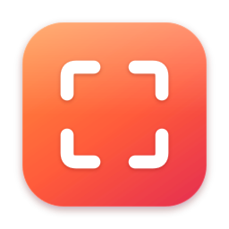

# Declic

**Capture, annotate, share — in one click.**
Screenshots, scrolling capture, video and GIF recording for macOS 14+.
A native app (Swift, ScreenCaptureKit), **free and open source** (MIT): everything stays on your Mac.

**[Download Declic](https://github.com/Lightmaster00/declic/releases/latest/download/Declic.dmg)** · [Website](https://lightmaster00.github.io/declic/) · [All releases](https://github.com/Lightmaster00/declic/releases)



## Install

1. Download `Declic.dmg`, open it and drag **Declic** into *Applications*.
2. On first launch, macOS may say the app comes from an unidentified developer:
   open *System Settings › Privacy & Security* and click **Open Anyway**.
3. Allow *Screen Recording* (and *Accessibility* for auto-scroll).

Later updates install from inside the app, in one click.

## Features

The interface follows the system language (English, French, Spanish, German, Japanese; English otherwise).
Every shortcut can be changed in **Settings › Shortcuts**.

| Default shortcut | Action |
|-----------|--------|
| ⌥⇧3 | Full-screen capture |
| ⌥⇧4 | Area capture — drag = area, Space = pick a window, Shift = square, Return = full screen, Escape = cancel |
| ⌥⇧5 | Window capture: every window spreads out, one click captures, you're back where you were instantly |
| ⌥⇧8 | Scrolling capture: pick the window, scroll (both directions) or use *Auto-scroll*, then *Done* |
| ⌥⇧6 | Recording: **Area**, **Full Screen** or **App**, as MP4 video or GIF |
| ⌥⇧H | Capture history |

- **Quick Access thumbnail** (bottom left): click = editor; on hover *Copy*, *Save* (with an animated
  confirmation), *Keep* (the thumbnail stays) and *Close*; drag and drop into any app; the stack
  scrolls when it's taller than the screen.
- **Annotation editor**: arrows, shapes, text, highlighter, pixelate, numbered steps, crop,
  undo / redo, zoom (pinch, ⌘+ / ⌘− / ⌘0 / ⌘1, Space + drag).
- **Scrolling capture**: Declic finds the area that scrolls under your pointer (ignoring toolbars and
  other panes) and stitches the content. Auto-scroll requires the *Accessibility* permission.
- **Recording**: resizable area, countdown, cursor and clicks, GIF export.
- **History**: every capture and video, with copy, save, annotate and delete.
- **Updates**: offered automatically as soon as a new version is published.

## Development

```bash
./build.sh install   # build, install /Applications/Declic.app and relaunch
./build.sh test      # automated tests
./build.sh run       # launch the build/ copy without installing it
./build.sh dmg       # build/Declic.dmg
```

- **Permissions are kept**: builds are signed with the "Declic Signing" certificate from your
  keychain (created on the first build), so *Screen Recording* and *Accessibility* aren't asked again.
- **Continuous integration**: every push builds the app, runs the tests and produces a DMG on a Mac
  (repository *Actions* tab).
- **Scrolling capture log**: `build/debug/scroll.log` (development build) or
  `~/Library/Logs/Declic/scroll.log`.

## Publishing a release

Releases are built and published by GitHub automatically
([Release workflow](.github/workflows/release.yml)):

1. Change `CFBundleShortVersionString` in `Resources/Info.plist` (e.g. `1.0.1`) and push to `main`.
2. GitHub tests the app, builds and signs it, and publishes `Declic.dmg` (downloads) and
   `Declic.zip` (in-app updates) on the [Releases](https://github.com/Lightmaster00/declic/releases) page.

Installed copies check for updates at launch and every 24 hours (can be turned off in
Settings › General) and offer *Install and Restart*.

**One-time setup** (repository owner): `./build.sh setup-signing` creates the signing certificate,
installs it in your keychain and stores it as a GitHub secret. Local builds and GitHub releases then
share the same signature, so updates are accepted and macOS keeps its permissions.

## Contributing

Contributions are welcome: open an *issue* to report a bug or suggest an idea, or a *pull request*
(the tests must pass: `./build.sh test`).

## Project layout

```
Sources/Declic/
  App.swift / AppDelegate.swift   entry point, menu bar menu, shortcuts
  Brand.swift                     colors and menu bar icon
  Capturer.swift                  ScreenCaptureKit + capture orchestration
  Overlay.swift                   area selection (cursors, handles)
  MissionControl.swift / WindowGallery.swift   window picker
  ScrollCapture.swift             scrolling capture (area detection, stitching)
  QuickAccess.swift               Quick Access thumbnails
  Editor.swift / EditorModel.swift   annotation editor
  Recording.swift                 video / GIF recording
  History.swift / Preview.swift   history, video preview
  Settings.swift / Prefs.swift / Shortcuts.swift / HotKeys.swift
  Updater.swift                   updates from GitHub releases
  Localization*.swift             interface strings (5 languages)
  UIComponents.swift / Util.swift
Tests/DeclicTests/                tests (stitching, pane detection, versions, gallery layout)
Branding/                         icon and brand guide (BRAND.md)
site/                             website (published with GitHub Pages)
```

## License

MIT — see [LICENSE](LICENSE). The "Declic" name and icon identify this project.
